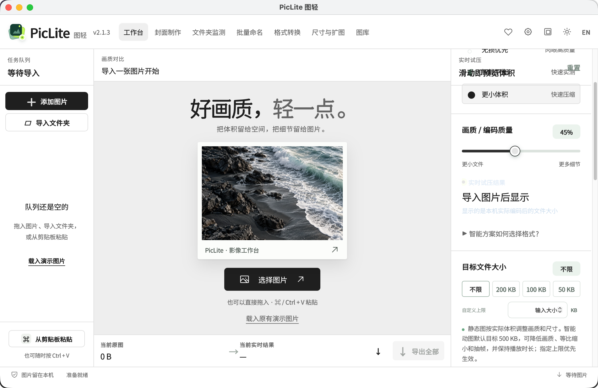
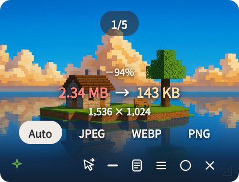
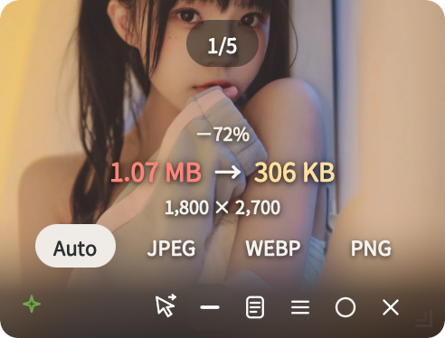
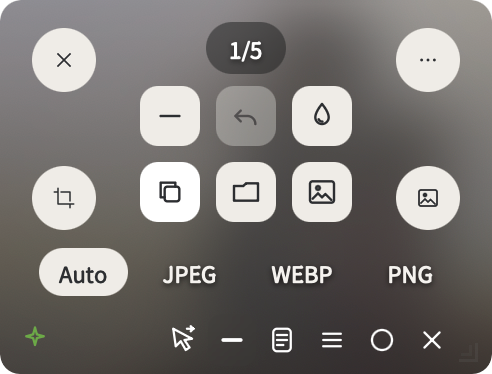
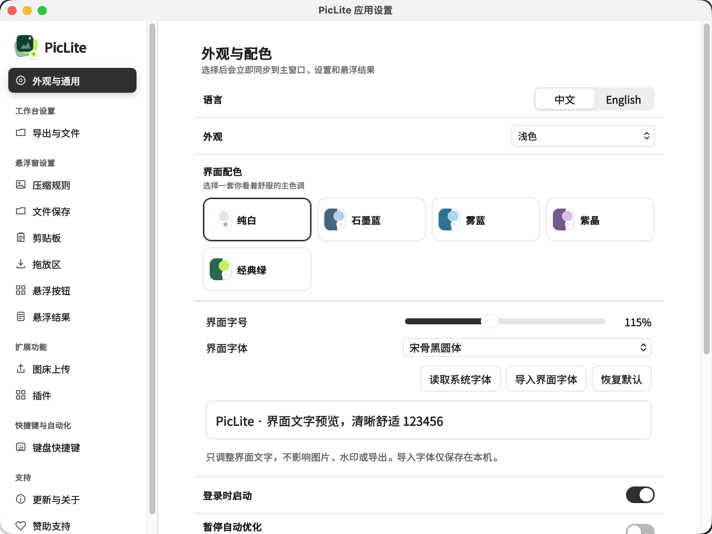

# PicLite

**Keep the detail. Lose the weight.**

A local image and animation workbench for compression, comparison, conversion, resizing and batch naming.

[Desktop downloads](https://github.com/amiaoapp/PicLite/releases) · [Web demo](https://amiaoapp.github.io/PicLite/) · [Floating window](#floating-window) · [中文](README.md) · [MCP setup](docs/MCP.md)



This README describes the current source. Published binaries and the hosted demo may use an earlier revision.

## What you can do

- Compare real JPEG, WebP and PNG encodes and export the smallest valid candidate. Transparent images skip JPEG.
- Batch compress, resize, set a target file size, and watermark images and GIFs while preserving animation.
- Use dedicated format conversion, resize/enlarge, parent-folder naming and local gallery tools.
- On desktop, automate clipboard and folder workflows, use global shortcuts and keep results in a floating window.
- Extend the workbench with trusted HTML/JavaScript plugins or call local image tools through MCP.

## Floating window

Process images without repeatedly switching back to the workbench. Enable clipboard optimisation in the desktop client to compress copied images automatically, drag local images into the floating window, or use **+** in the empty window to select files. Open it from the main window's top-right control or the menu bar / system tray.

| Image compression result | Photo example | Hover actions |
| :---: | :---: | :---: |
|  |  |  |

These screenshots use custom action buttons and interface typography. Both can be configured to suit your workflow.

- **See the result and use it.** The image fills the preview, with original and output sizes, savings and dimensions centred over it. Switch between Auto, JPEG, WebP and PNG at the bottom. Hover to reveal actions; move away to return to the image.
- **Six configurable actions.** The defaults are downscale, undo, quality, copy, upload and save a copy. Replace or reorder them in **Settings → Floating action buttons**. The overflow menu also offers image preview, file reveal and watermarking. Uploading requires a configured image host.
- **Browse multiple images.** In stacked mode, use the page indicator or mouse wheel to switch results. Choose **Expand results** in the footer to scroll through images at the current window's proportions. Browsing preserves their order.
- **Crop or make a cover.** The lower-left button opens the separate crop editor. The lower-right button makes and compresses a cover using your saved preset. Configure it once in **Cover maker**; the settings save automatically and can then be reused from the floating window.
- **Place it where it works for you.** Move and resize the window, adjust its corner radius, collapse it to a draggable icon, or enable auto hide and click-through. Click-through dims the window; the footer toggle restores interaction. Appearance and result presentation are available under **Settings → Floating Results**.

Floating windows, continuous clipboard monitoring and global shortcuts require the desktop client. Keep the menu bar / tray process running to continue these workflows after closing the main window.

## Desktop and browser

Windows, macOS and Linux packages are available in [Releases](https://github.com/amiaoapp/PicLite/releases). Browser and Docker editions process images locally in the visitor's browser and export through browser downloads or authorized file access.

Choose **Classic** or **Studio** from the top-right Interface style control. Classic remains the default. Switching appearance preserves the current queue, settings and results; both layouts use the original processing code. All five colour palettes and light/dark/system modes remain available.

Format conversion, resizing and enlarging are available in both the desktop and browser editions. Parent-folder batch naming, continuous monitoring, global shortcuts and floating windows require the desktop client. Direct file writes require browser File System Access support and explicit permission.



## Docker

```bash
docker run -d --name piclite -p 3456:3456 \
  --restart unless-stopped ghcr.io/amiaoapp/piclite:latest
```

Open `http://localhost:3456`. To build the current source:

```bash
docker compose -f docker-compose.yml -f docker-compose.build.yml up -d --build
```

No image-directory mount is required. The container serves the application; the browser processes images. Use HTTPS for browser capabilities that require a secure context.

## Develop

Node.js 22.13+ is required. Desktop builds also need Rust stable and Tauri 2 platform dependencies.

```bash
npm ci
npm run dev
npm run desktop:dev
npm test
npm run pages:build
```

## Agents, plugins and license

Run `piclite --mcp` for the built-in stdio server. Compatible MCP clients can inspect local images, batch compress and resize images or animations, and create covers from configuration. ChatGPT requires an MCP bridge; see the [MCP guide](docs/MCP.md).

Import trusted local HTML/JavaScript plugins in Settings. URL plugins are subject to browser CORS rules. [Plugin development guide](docs/PLUGIN_DEVELOPMENT.en-US.md).

Images remain local unless you explicitly upload them to a configured service. PicLite is [GPL-3.0-or-later](LICENSE), with desktop workflows adapted from [Clop](https://github.com/FuzzyIdeas/Clop). See [third-party notices](THIRD_PARTY_NOTICES.md), including UI dependencies and the generated decorative photograph.
