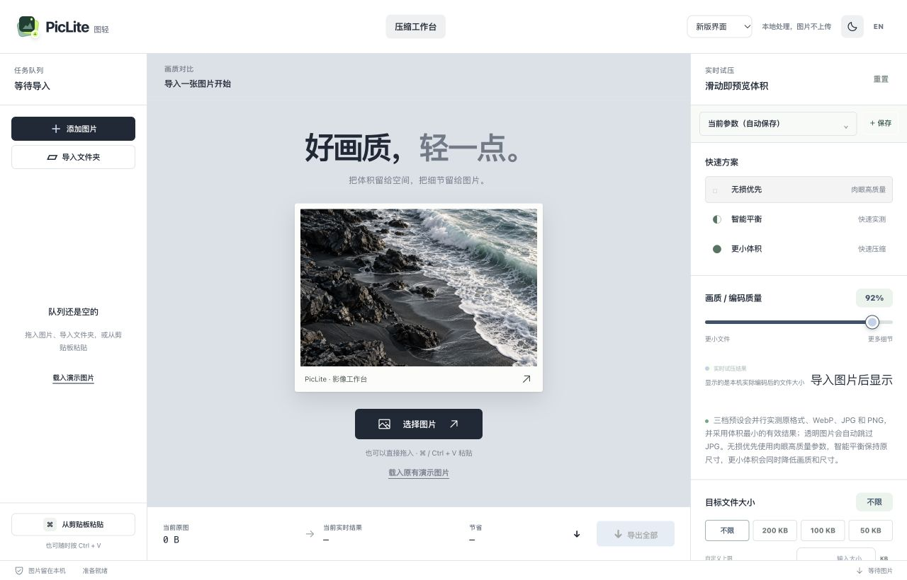
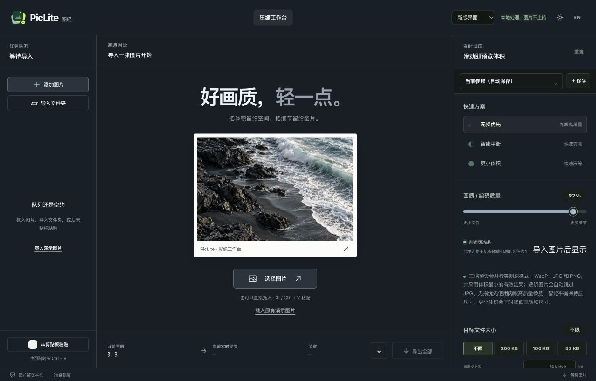

<div align="center">

# PicLite 图轻

**好画质，轻一点。**

图片与动图的本地处理工作台：压缩、对比、转换、缩放、命名，一处完成。

[下载桌面版](https://github.com/amiaoapp/PicLite/releases) · [在线体验](https://amiaoapp.github.io/PicLite/) · [Docker 部署](#web-与-docker) · [MCP 接入](docs/MCP.md) · [English](README.en-US.md)

</div>



> 本 README 描述当前源码。已发布安装包和在线演示的功能以各自版本为准；体验尚未发布的更新请从源码构建。

## 从一张图片开始

拖入图片或文件夹，选择压缩方案，拖动对比线检查细节，再导出结果。质量、尺寸和目标大小变化后，会显示实际编码得到的体积。

- **智能择优**：测量 JPEG、WebP、PNG 等候选结果，选择更小的有效文件；透明图片跳过 JPEG。
- **图片与动图**：批量压缩、等比缩放、文字/图片水印、目标文件大小；GIF 添加水印后仍保留动画。
- **独立工具**：格式转换、尺寸调整与扩图、父目录规则批量重命名、本地图库。
- **桌面自动化**：复制图片触发优化、全局快捷键、多目录监测和悬浮结果；关闭主窗口后继续在菜单栏/托盘工作。
- **按需扩展**：导入可信的 HTML/JavaScript 工作台插件，或通过 MCP 让智能体调用图片处理能力。

<details>
<summary>查看深色界面</summary>



</details>

## 界面可以自己选

右上角“界面样式”可选择 **经典旧版** 或 **新版界面**，默认保留经典旧版，选择会自动记住。切换外观保留当前图片、压缩参数和结果。

两套界面共用原来的压缩、GIF、水印、导出和插件逻辑。石墨、雾蓝、紫灰、经典绿四种配色，以及浅色、深色和跟随系统外观均保留；界面布局和颜色主题分别设置。

## 选择适合的版本

| 能力 | 桌面端 | 浏览器 / Docker |
| --- | --- | --- |
| 图片批量压缩、对比、尺寸与水印 | 支持 | 支持，在浏览器本机处理 |
| 经典 / 新版界面切换 | 支持 | 支持 |
| 格式转换、尺寸调整、父目录批量命名插件 | 支持 | 使用桌面端 |
| 持续剪贴板监听、全局快捷键、目录监测、悬浮窗 | 支持 | 使用桌面端 |
| 写入原目录或覆盖源文件 | 支持 | 需要浏览器支持文件授权，并手动确认权限 |
| MCP 本地文件操作 | 内置 stdio 服务 | HTTP 桥接见 [MCP 文档](docs/MCP.md) |

## 桌面安装与常用工作流

前往 [Releases](https://github.com/amiaoapp/PicLite/releases) 下载对应架构：

| 系统 | 安装包 |
| --- | --- |
| Windows x64 / ARM64 | EXE、MSI、便携 ZIP |
| macOS Apple Silicon / Intel | DMG |
| Linux x64 / ARM64 | AppImage、DEB |

macOS 当前构建采用 ad-hoc 签名，首次启动请按系统提示处理。

**悬浮窗**：拖放、粘贴或快捷键唤出，处理后可复制、预览、定位、撤销、继续缩小、加水印或上传图床。空窗会随窗口整体缩放，底栏按钮保持固定可见；开启鼠标穿透后降低透明度，仍可通过开关恢复。

**文件夹监测**：添加互不重叠的输入目录，每个任务独立设置格式、质量、尺寸、输出和命名规则。软件等待文件写入稳定，跳过生成结果并检查输出循环；保存的任务重启后恢复。关闭窗口后仍需让菜单栏/托盘进程保持运行。

**图床上传**：桌面端支持 WebDAV、S3/R2、OSS、FTP、SFTP。只有主动上传时才向配置的服务发送图片。

## Web 与 Docker

[在线演示](https://amiaoapp.github.io/PicLite/) 无需安装。Docker 提供同一套网页压缩工作台，图片处理发生在访问者的浏览器，容器不需要挂载图片目录。图库也属于当前浏览器，不在多台设备间同步。

使用已发布镜像：

```bash
docker run -d --name piclite \
  -p 3456:3456 --restart unless-stopped \
  ghcr.io/amiaoapp/piclite:latest
```

打开 `http://服务器IP:3456`。使用 Compose：

```bash
git clone https://github.com/amiaoapp/PicLite.git
cd PicLite
docker compose up -d
```

当前源码构建：

```bash
docker compose -f docker-compose.yml -f docker-compose.build.yml up -d --build
```

可在 `.env` 中设置 `PICLITE_PORT=3456`、`PICLITE_BIND=127.0.0.1` 或 `PICLITE_TAG=2.0.0`。通过反向代理对外提供服务时，将域名转发到 `127.0.0.1:3456`；粘贴等浏览器能力通常需要 HTTPS 或 localhost。

升级执行 `docker compose pull && docker compose up -d`；状态与日志使用 `docker compose ps` 和 `docker compose logs -f piclite`。

## 智能体与插件

桌面程序内置 MCP。通过 `piclite --mcp` 启动 stdio 服务，智能体可以检查图片、批量压缩和缩放图片/动图。Claude、Hermes、WorkBuddy 等支持标准 MCP 的客户端可配置使用；ChatGPT 通过 HTTPS MCP 桥接接入，具体权限与配置见 [MCP 指南](docs/MCP.md)。

在桌面端“设置 → 插件”启用内置工具，或导入 `.html`、`.js`、`manifest.json`。插件执行的是你信任的代码，请先审阅来源。

[中文插件开发指南](docs/PLUGIN_DEVELOPMENT.md) · [English plugin guide](docs/PLUGIN_DEVELOPMENT.en-US.md)

## 开发与验证

需要 Node.js 22.13+；桌面构建另需 Rust stable 和对应平台的 Tauri 2 系统依赖。

```bash
npm ci
npm run dev                  # Web 开发
npm run desktop:dev          # Tauri 桌面开发
npm test                     # 网页与原生回归测试
npm run pages:build          # 静态 Web 构建
npm run desktop:preview:mac   # 当前 Mac 架构的 Release 预览包
```

[问题反馈](https://github.com/amiaoapp/PicLite/issues) 时请提供版本、系统、复现步骤与脱敏后的错误信息。

## 隐私与许可证

图片默认留在本机。网页图库使用 IndexedDB，清理站点数据会移除记录；需要留存的结果请及时导出。图片样张为专门生成的演示素材。

PicLite 以 [GPL-3.0-or-later](LICENSE) 发布。桌面自动化工作流借鉴并改编自 [FuzzyIdeas/Clop](https://github.com/FuzzyIdeas/Clop)；PicLite 不使用其商标。第三方依赖与致谢见 [THIRD_PARTY_NOTICES.md](THIRD_PARTY_NOTICES.md)。
